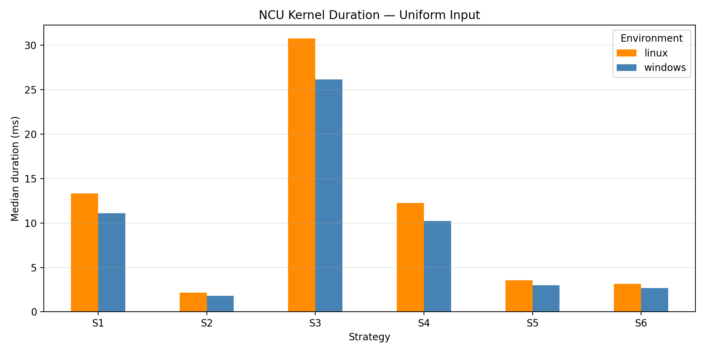
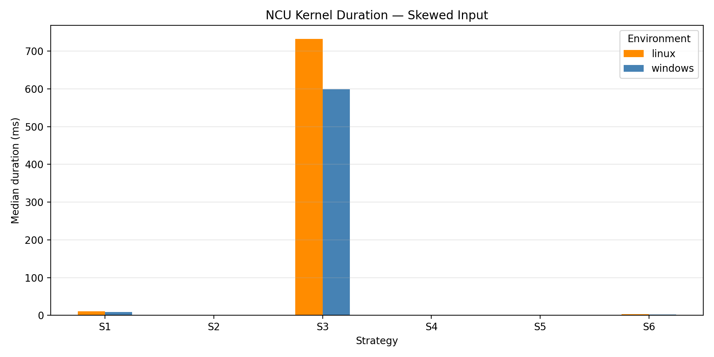
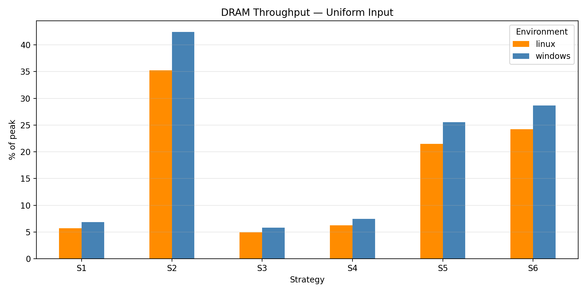
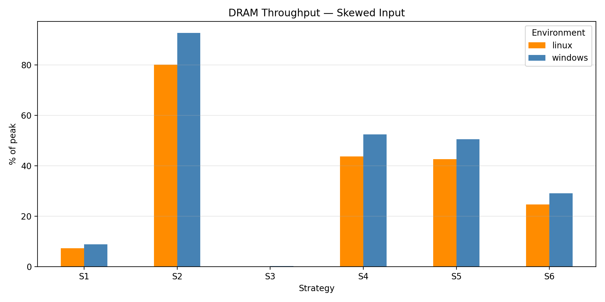
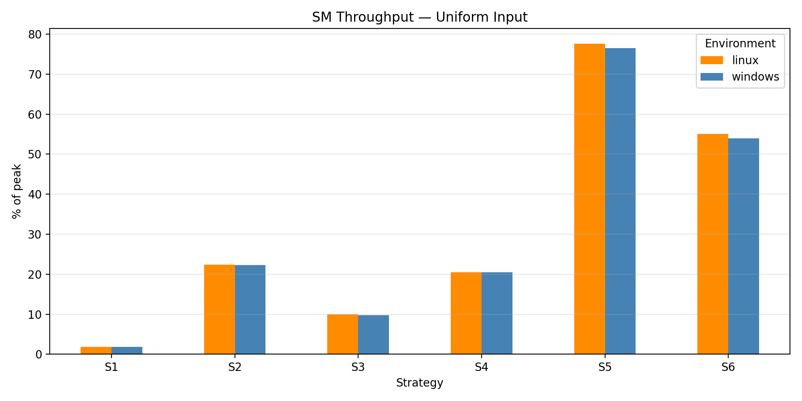
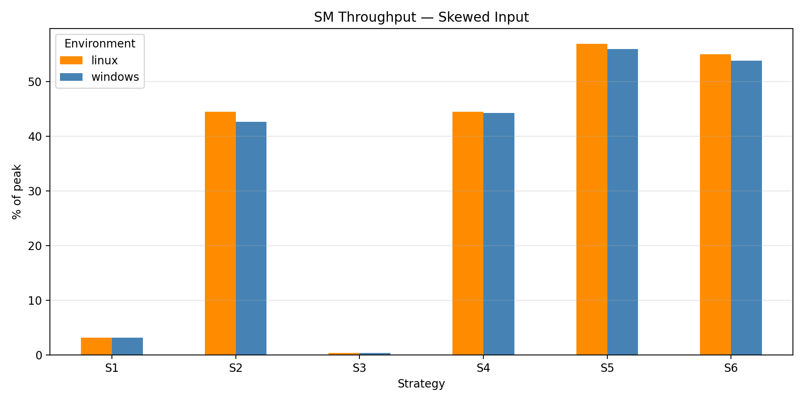
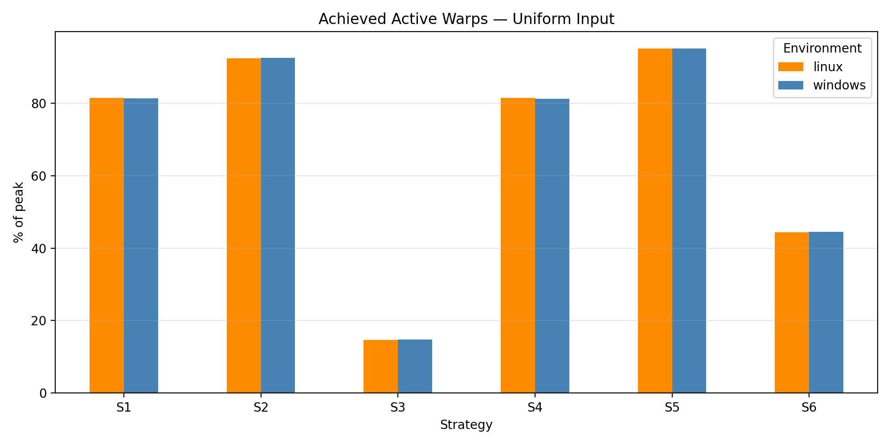
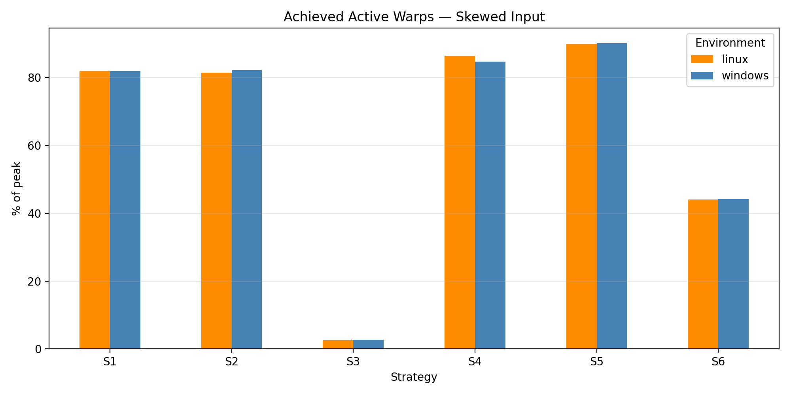
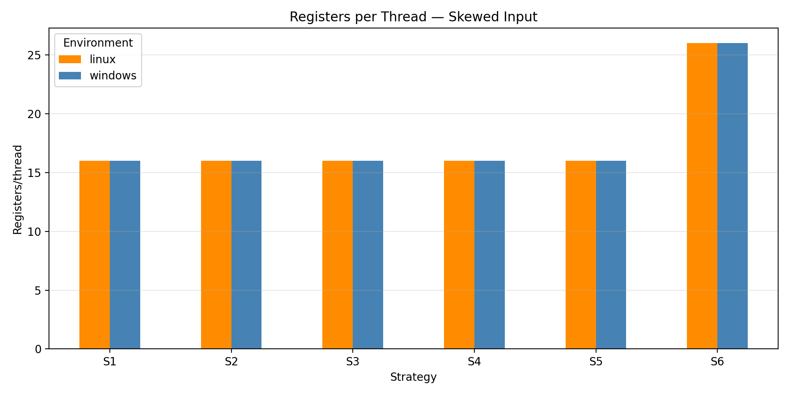
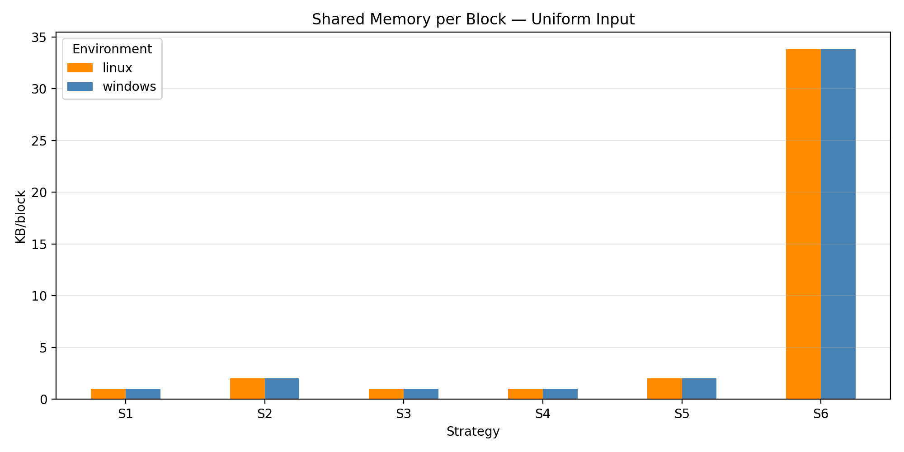

# Nsight Compute (NCU) Analysis

## 1. Overview

This document presents the Nsight Compute (NCU) profiling analysis of six CUDA histogram implementations across Windows and Linux (WSL2).

The purpose is to understand how the six kernel strategies behave under uniform and skewed input distributions, and to compare their GPU execution characteristics across the two environments.

The analysis uses the existing NCU profiling reports and their extracted CSV metrics. No new profiling runs were performed for this analysis.

## 2. Experimental Configuration

| Parameter | Configuration |
|---|---|
| GPU | NVIDIA GeForce RTX 3050 Laptop GPU |
| GPU memory | 6 GB |
| Input size | 32,000,000 elements |
| Histogram bins | 256 |
| NCU block size | 256 threads |
| Input distributions | Uniform and skewed |
| Environments | Windows and Linux (WSL2) |
| Windows CUDA Toolkit | 13.4 |
| Linux CUDA Toolkit | 13.1 |
| Linux NCU version | 2025.4.1.0 |
| NCU reports | 24 standard reports |
| Kernel launches per report | 12 |

Each environment contains six strategies profiled on both input distributions.

**Important:** NCU measurements are profiler measurements. They should not be treated as interchangeable with the ordinary benchmark timings. The NCU comparison uses block size 256 only.

## 3. Kernel Strategies

| Strategy | Implementation | Description |
|---|---|---|
| S1 | Global baseline | Direct global-memory histogram updates |
| S2 | Shared-memory privatization | Each block builds a shared histogram before merging into the global histogram |
| S3 | Sort-reduce | Sorted input is processed by detecting and counting consecutive runs |
| S4 | Warp register aggregation | Aggregation is performed at warp level using registers |
| S5 | Warp-shared hybrid | Combines warp-level aggregation with shared-memory aggregation |
| S6 | Per-warp shared | Uses separate shared-memory histogram storage for individual warps |

## 4. NCU Metrics

The following metrics were extracted:

- `gpu__time_duration.avg`: GPU kernel duration.
- `gpu__dram_throughput.avg.pct_of_peak_sustained_elapsed`: DRAM throughput as a percentage of peak.
- `gpu__compute_memory_throughput.avg.pct_of_peak_sustained_elapsed`: Combined compute/memory throughput metric as reported by NCU.
- `sm__throughput.avg.pct_of_peak_sustained_elapsed`: SM throughput as a percentage of peak.
- `sm__warps_active.avg.pct_of_peak_sustained_active`: Achieved active warps as a percentage of peak.
- `launch__registers_per_thread`: Registers allocated per thread.
- `launch__shared_mem_per_block`: Shared memory allocated per block.
- `launch__occupancy_per_block_size`: Raw occupancy-related launch metric.

The occupancy-related launch metric is retained as a raw value. It is not interpreted as a percentage. Achieved active warps is discussed separately.

## 5. Kernel Duration Comparison

All values below are median NCU durations in milliseconds.

### 5.1 Uniform Input

| Strategy | Linux (ms) | Windows (ms) |
|---|---:|---:|
| S1 | 13.342 | 11.120 |
| S2 | 2.170 | 1.804 |
| S3 | 30.757 | 26.147 |
| S4 | 12.270 | 10.232 |
| S5 | 3.557 | 2.992 |
| S6 | 3.153 | 2.666 |

### 5.2 Skewed Input

| Strategy | Linux (ms) | Windows (ms) |
|---|---:|---:|
| S1 | 10.350 | 8.600 |
| S2 | 0.955 | 0.826 |
| S3 | 731.897 | 599.327 |
| S4 | 1.749 | 1.457 |
| S5 | 1.794 | 1.511 |
| S6 | 3.103 | 2.627 |

### 5.3 Interpretation

Strategy 2 achieves the lowest NCU duration in all four environment and distribution combinations.

For uniform input, Strategy 2 is followed by Strategy 6 and Strategy 5. For skewed input, Strategy 2 is followed by Strategy 4 and Strategy 5.

Strategy 3 exhibits a very large duration increase for skewed input. Its measured duration is approximately 599 ms on Windows and 732 ms on Linux, compared with approximately 26 ms and 31 ms respectively for uniform input.

This behavior is consistent with the sort-reduce implementation. After sorting, the kernel detects consecutive runs and counts their lengths. Skewed input can produce long runs, causing uneven amounts of work across threads.

The ordinary benchmark measurements independently show the same trend:

| Environment | Uniform S3 (ms) | Skewed S3 (ms) |
|---|---:|---:|
| Windows | 20.830 | 491.518 |
| Linux | 23.310 | 490.382 |

The NCU measurements are higher than ordinary benchmark measurements, particularly for Strategy 3. Therefore, ordinary benchmark timings should be used for the main performance ranking, while NCU results should be used to study kernel behavior and hardware metrics.

## 6. DRAM Throughput

DRAM throughput indicates how much of the GPU's sustained peak DRAM throughput is being utilized during the measured execution.

### 6.1 Uniform Input

| Strategy | Linux (%) | Windows (%) |
|---|---:|---:|
| S1 | 5.74 | 6.88 |
| S2 | 35.23 | 42.38 |
| S3 | 4.97 | 5.85 |
| S4 | 6.24 | 7.48 |
| S5 | 21.49 | 25.55 |
| S6 | 24.25 | 28.68 |

### 6.2 Skewed Input

| Strategy | Linux (%) | Windows (%) |
|---|---:|---:|
| S1 | 7.39 | 8.89 |
| S2 | 80.13 | 92.60 |
| S3 | 0.21 | 0.26 |
| S4 | 43.72 | 52.48 |
| S5 | 42.63 | 50.58 |
| S6 | 24.64 | 29.10 |

### 6.3 Interpretation

Strategy 2 has the highest DRAM throughput among the six strategies for both input distributions.

Its DRAM throughput reaches 92.60% of peak on Windows and 80.13% on Linux for skewed input. This indicates substantial memory-system activity during the measured execution.

Strategy 3 has extremely low DRAM throughput for skewed input. This is consistent with its very long execution time and the limited amount of useful GPU work being completed during the run. Low DRAM throughput alone does not establish the exact bottleneck.

## 7. SM Throughput

SM throughput represents the utilization of the GPU streaming multiprocessors relative to their sustained peak.

### 7.1 Uniform Input

| Strategy | Linux (%) | Windows (%) |
|---|---:|---:|
| S1 | 1.82 | 1.81 |
| S2 | 22.34 | 22.29 |
| S3 | 10.00 | 9.73 |
| S4 | 20.51 | 20.47 |
| S5 | 77.55 | 76.48 |
| S6 | 55.05 | 53.99 |

### 7.2 Skewed Input

| Strategy | Linux (%) | Windows (%) |
|---|---:|---:|
| S1 | 3.17 | 3.17 |
| S2 | 44.50 | 42.67 |
| S3 | 0.42 | 0.42 |
| S4 | 44.47 | 44.26 |
| S5 | 56.88 | 55.99 |
| S6 | 54.97 | 53.84 |

### 7.3 Interpretation

Strategy 5 achieves the highest SM throughput for both input distributions.

For uniform input, its SM throughput is approximately 76–78% of peak. For skewed input, it is approximately 56–57%.

Strategy 6 also shows relatively high SM throughput, while Strategy 1 has very low SM throughput.

A higher SM throughput does not automatically mean a shorter kernel duration. Strategy 5, for example, has higher SM throughput than Strategy 2 but takes longer to execute. Throughput metrics must therefore be interpreted together with duration and the other hardware metrics.

## 8. Achieved Active Warps

This metric measures achieved active warps relative to the peak sustained active-warps level.

### 8.1 Uniform Input

| Strategy | Linux (%) | Windows (%) |
|---|---:|---:|
| S1 | 81.48 | 81.32 |
| S2 | 92.39 | 92.48 |
| S3 | 14.69 | 14.82 |
| S4 | 81.47 | 81.22 |
| S5 | 94.98 | 95.00 |
| S6 | 44.38 | 44.50 |

### 8.2 Skewed Input

| Strategy | Linux (%) | Windows (%) |
|---|---:|---:|
| S1 | 81.99 | 81.93 |
| S2 | 81.48 | 82.29 |
| S3 | 2.65 | 2.73 |
| S4 | 86.38 | 84.72 |
| S5 | 89.95 | 90.12 |
| S6 | 44.03 | 44.16 |

### 8.3 Interpretation

Strategy 5 achieves the highest active-warps percentage for uniform input, at approximately 95%.

Strategy 2 also maintains high active-warps values, around 92% for uniform input and 81–82% for skewed input.

Strategy 3 has very low achieved active-warps values for skewed input, approximately 2.7%. This is consistent with the highly uneven work distribution associated with long runs in its sort-reduce implementation.

Strategy 6 has lower achieved active-warps values, around 44%, in both distributions.

## 9. Register Usage

Register usage is consistent across Windows and Linux and does not change with input distribution.

| Strategy | Registers per thread |
|---|---:|
| S1 | 16 |
| S2 | 16 |
| S3 | 16 |
| S4 | 16 |
| S5 | 16 |
| S6 | 26 |

Strategy 6 uses 26 registers per thread, while the other five strategies use 16.

Higher register usage can affect the number of resident warps and resource allocation. However, register count alone does not establish that register pressure is the cause of a performance difference.

## 10. Shared Memory Usage

The extracted metric reports shared memory in Kbyte/block.

| Strategy | Shared memory (KB/block) |
|---|---:|
| S1 | 1.024 |
| S2 | 2.048 |
| S3 | 1.024 |
| S4 | 1.024 |
| S5 | 2.048 |
| S6 | 33.792 |

Strategy 6 has the highest shared-memory allocation at 33.792 KB per block. This is consistent with its per-warp shared-memory design.

Strategies 2 and 5 use 2.048 KB per block in the extracted metric, while Strategies 1, 3 and 4 use 1.024 KB.

The larger shared-memory allocation in Strategy 6 is an important resource consideration when evaluating occupancy and scalability.

## 11. Windows and Linux Comparison

The two environments show similar hardware metric patterns:

- Register usage is identical across environments.
- Shared-memory allocations are identical.
- Achieved active-warps values are close.
- SM throughput trends are similar.
- The relative behavior of the six strategies is broadly consistent.

Windows has lower measured NCU durations than Linux for every strategy and distribution in this dataset.

For example:

| Configuration | Windows (ms) | Linux (ms) |
|---|---:|---:|
| S2 uniform | 1.804 | 2.170 |
| S2 skewed | 0.826 | 0.955 |
| S3 uniform | 26.147 | 30.757 |
| S3 skewed | 599.327 | 731.897 |

These results describe the tested configurations. They do not establish that Windows is inherently faster than Linux. Differences in driver, toolkit, operating-system and profiling environments may contribute, and further controlled testing would be required to isolate their effects.

## 12. Important Measurement Considerations

### 12.1 Duration units

The original NCU CSV files did not all use the same duration unit.

The Strategy 2 skewed-input reports for both Windows and Linux reported duration in microseconds (`us`), while the remaining reports used milliseconds (`ms`).

These values were converted before comparison:

- Windows Strategy 2 skewed: 825.7 us = 0.8257 ms.
- Linux Strategy 2 skewed: 954.7 us = 0.9547 ms.

The comparison uses the corrected `duration_median_ms` values in `ncu_comparison_summary_final.csv`.

### 12.2 NCU duration versus ordinary benchmark duration

NCU profiling and ordinary benchmark execution are different measurement contexts. The NCU duration values should not replace the ordinary benchmark results when presenting end-to-end performance.

### 12.3 Scope

The NCU comparison covers block size 256. It does not establish which block size is best overall. Block-size tuning results should be discussed using the ordinary benchmark datasets.

## 13. Graphs

The following graphs compare Windows and Linux for each input distribution.

### Kernel Duration

**Uniform input**

**Skewed input**

### DRAM Throughput

### SM Throughput

### Achieved Active Warps

### Register Usage

### Shared Memory

## 14. Overall Findings

1. Strategy 2 achieves the lowest NCU duration for all four environment and input combinations.
2. Strategy 3 is highly sensitive to input distribution. Its skewed-input execution time increases dramatically.
3. Strategy 5 achieves the highest SM throughput and achieved active-warps percentage for uniform input.
4. Strategy 6 has the highest register and shared-memory requirements among the six strategies.
5. Windows and Linux show similar hardware metric trends, although the measured durations differ.
6. NCU profiling complements ordinary benchmark timing by providing hardware utilization and resource-allocation information.

The results demonstrate that histogram performance depends not only on the choice of aggregation strategy, but also on input distribution and GPU resource usage.

## 15. Data Locations

Original NCU reports:

- `reports/ncu/` — Windows NCU reports.
- `reports/linux_ncu/` — Linux NCU reports.

Extracted metrics:

- `reports/ncu_metrics/windows/`
- `reports/ncu_metrics/linux/`
- `reports/ncu_metrics/ncu_all_metrics_summary.csv`
- `reports/ncu_metrics/ncu_comparison_summary_final.csv`
- `reports/ncu_metrics/ncu_master_comparison.csv`

Visualizations:

- `comparison_graphs/ncu/`

## 16. Detailed Resource Analysis: Strategy 2 versus Strategy 6

A closer examination of the source implementation and extracted NCU metrics reveals an important resource-allocation difference between shared-memory privatization (S2) and per-warp shared histograms (S6).

### 16.1 Source-level shared-memory allocation

Strategy 2 declares:

\`\`\`cpp
__shared__ unsigned int s_hist[BINS];
\`\`\`

With 256 bins and 4-byte unsigned integer counters, the logical histogram occupies:

\[
256 \times 4 = 1024 \text{ bytes}
\]

Strategy 6 declares:

\`\`\`cpp
__shared__ unsigned int warp_hist[32][BINS];
\`\`\`

Its logical counter array occupies:

\[
32 \times 256 \times 4 = 32768 \text{ bytes}
\]

or 32 KiB.

For a block size of 256 threads, the block contains eight warps. Therefore, only eight of the 32 declared histogram rows are used by the current implementation.

### 16.2 NCU-reported resource usage

For the Windows skewed-input reports, NCU reports:

| Metric | S2 | S6 |
|---|---:|---:|
| Shared memory per block | 2.048 KB | 33.792 KB |
| Registers per thread | 16 | 26 |
| Achieved active warps | 82.29% | 44.16% |
| DRAM throughput | 92.61% | 29.22% |

The NCU-reported shared-memory allocation is higher than the logical source-level array size. The available measurements establish the reported allocation, but do not independently identify the reason for the additional allocation. The NCU launch configuration should be consulted before attributing the difference to a specific source.

### 16.3 Performance implications

S6 separates histogram updates by warp, reducing inter-warp contention on shared histogram bins. However, this approach requires substantially more shared-memory storage and more registers per thread than S2.

The lower achieved active-warps percentage observed for S6 is consistent with a less favorable resource profile. Shared-memory allocation can limit the number of blocks resident on an SM, while register allocation also contributes to residency constraints.

These measurements do not prove that shared-memory capacity or register pressure is the sole cause of S6's performance. They establish a clear resource trade-off that should be considered when evaluating the design.

### 16.4 Potential optimization

For a fixed block size of 256, the kernel uses eight warps. A specialized implementation could allocate eight histogram rows instead of 32:

\[
8 \times 256 \times 4 = 8192 \text{ bytes}
\]

This reduces the logical counter-array requirement from 32 KiB to 8 KiB.

The optimization must preserve correct warp indexing and initialization. It should be benchmarked separately rather than assumed to improve performance.

## 17. Additional Interpretation Notes

- The logical shared-memory array size in source code and the shared-memory allocation reported by NCU are distinct quantities.
- Achieved active warps is a utilization measurement, not a direct measurement of theoretical occupancy.
- High DRAM throughput does not independently prove that a kernel is exclusively memory-bound.
- Resource usage, throughput and execution duration must be interpreted together.
